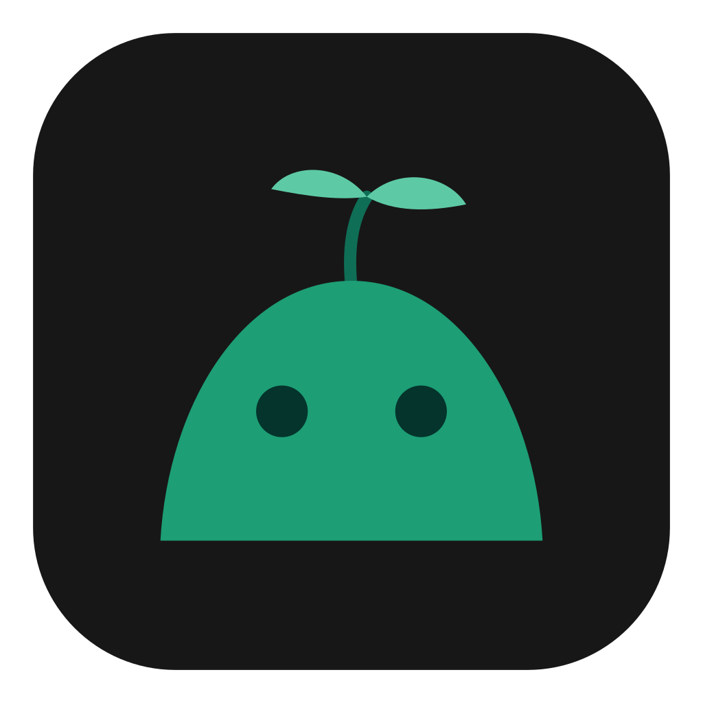

<p align="center"></p>

<h1 align="center">ihz.land</h1>

<p align="center">A living island at the top of your screen, for Windows.<br>
A personal fork of <a href="https://github.com/lucacadalora/oyenza-studio">Oyenza Studio</a> (MIT).</p>

<p align="center"><a href="https://ihzaskip.github.io/ihz-land/">Website</a> ·
<a href="https://github.com/ihzaskip/ihz-land/releases/latest/download/ihz-land-Setup.exe">Download for Windows</a> ·
<a href="PRIVACY.md">Privacy</a></p>

ihz.land draws a small black island at the top centre of your screen. Point at it (or click it) and it opens:
music with lyrics in time, your day, a shelf for files, tasks, a focus timer, and the add-ons you switch on.

## What's on the island

- **Music.** The song from any app that uses Windows' media controls (Spotify, Apple Music, a browser), with
  synced lyrics from LRCLIB and readings under Japanese, Korean and Chinese lines.
- **Today.** The date, five weeks at a glance and four tiles: CPU, memory, disk and battery (or uptime).
- **Shelf and phone drop.** Park files on the island, drag them out again, and send files between your phone
  and your PC over the same Wi-Fi.
- **Tasks and Focus.** A short list for the day, and a focus timer that counts your sessions.
- **Pop-ups.** Volume, charging, Bluetooth headphones, a new song's title.
- **Themes.** Classic, Pulo, Glass, Pill and Diorama.

Add-ons, the **+** at the end of the tab row, stay off until you switch them on:
Prayer times, Japanese readings, Script reader, System, Caffeine, Screen recorder, AI usage, IELTS and Downloader.
Every one of them works without an account.

### Pulo

Pulo is ihz.land's own character: a small green island with a sprout. In the Pulo theme it lives in the
island, peeking over its edge, bopping to the music and sleeping at night. It's drawn in code
(`crates/poni/src/oyen.rs`), and `tools/make_brand.py` draws the icon and installer pictures from the same shapes.

### IELTS coach

Pulo asks IELTS Speaking questions out loud, listens to your answers and gives you a band with a roast in
Jakarta gaul. It runs on [Teman IELTS](https://temanielts.com) and needs you signed in to ihz.app.

### Signing in to ihz.app (optional)

Right-click the island (or the tray icon) › **ihz.app** › **Sign in to ihz.app…**, or use the account row at the
top of Settings. The island shows an 8-letter code; approve it at **ihz.app/device** while signed in there, and this
PC gets a key of its own, sealed for your Windows account. No password is ever typed into the app.
**Disconnect** removes the key here and tells ihz.app. Only the IELTS coach uses it.

## Light by design

Nothing runs at rest unless you switched it on or its page is open. The island draws on the GPU in step with
your display and draws nothing while nothing moves. Add-ons download only when you switch them on, and
switching one off deletes its files. [AGENTS.md](AGENTS.md) has the rules every change follows.

## Install

**[Download ihz-land-Setup.exe](https://github.com/ihzaskip/ihz-land/releases/latest/download/ihz-land-Setup.exe)**
and run it. It installs just for you and needs no admin rights. Builds aren't code-signed, so Windows SmartScreen
may say "Windows protected your PC": click **More info → Run anyway**.

Your data lives in `%APPDATA%\Poni\`, cache and log in `%LOCALAPPDATA%\Poni\` (the internal names stay the
original project's, so updates from it merge cleanly). Uninstalling keeps your data.

New versions come from this fork's own signed update file
(`https://ihzaskip.github.io/ihz-land/latest.json`). When the original project releases, the island says so
once and links to its release page; nothing of it is downloaded.

## Guides

### Apple Music lyrics

With an Apple Music subscription, ihz.land can show Apple Music's own synced lyrics; LRCLIB stays the backup.
Copy your token once from the web player:

1. Open [music.apple.com](https://music.apple.com) in Chrome or Edge and sign in.
2. Press F12, open **Application** → **Cookies** → `https://music.apple.com`, and copy `media-user-token`.
3. Right-click the island (or the tray icon) → **Apple Music lyrics** → **Use token from clipboard**.

The token is stored encrypted for your Windows account and cleared from the clipboard. It uses the web player's
own API, which Apple doesn't publish for other apps, so it can stop working when Apple changes its site.

### Phone drop

Shelf › **Phone** shows a QR code: scan it with a phone on the same Wi-Fi to send files both ways. **Pair a
phone** lets a paired phone reach the PC from any network through a small meeting server, `drop.ihz.app`
(code in [`server/`](server), hosted from [ihzaskip/drop-ihz](https://github.com/ihzaskip/drop-ihz)); that server
isn't online yet, so pairing waits for it. How it works: [docs/paired-drop.md](docs/paired-drop.md).

### Prayer times

Today's times for your city, with a reminder before each prayer and the adzan. Cities outside Indonesia are
looked up from the original project's place lists at `studio.oyenza.com/places`.

## Build

A Cargo workspace: `crates/poni-core` (pure logic, tested on any OS), `crates/studio-usage` (the AI tab's
readers), `crates/studio-diorama` (the Diorama theme's picture) and `crates/poni` (the app: Win32, Direct2D and
WinRT on Windows; the Mac code is in `src/mac/` and type-checks with `cargo mcheck`).

```
cargo test --workspace
cargo build -p poni --release        # target\release\poni.exe
```

With the GNU toolchain and MinGW instead of MSVC: `cargo wbuild` (`target/x86_64-pc-windows-gnu/release/poni.exe`).
`poni.exe --selftest <dir>` draws every island state into PNGs and checks them (`PONI_SELFTEST_THEME=oyen` for Pulo).

A `v*` tag on this repository builds, tests and publishes a release (`.github/workflows/ci.yml`), and the Website
workflow publishes the page and the signed update file; run `ci` by hand with `release_dry_run` to try it without
publishing. The update file is signed with the `UPDATE_FEED_KEY` secret of the `release` environment
([docs/updates.md](docs/updates.md)).

### Following the original project

```
git fetch upstream
git merge upstream/main
```

Internal names (`poni.exe`, the crates, the `Poni` data folder, `PONI_*`, `Theme::Oyen`) are unchanged to keep
those merges small. [RENCANA-IHZLAND.md](RENCANA-IHZLAND.md) records what this fork changed and why.

## Credits and license

ihz.land is a fork of [lucacadalora/oyenza-studio](https://github.com/lucacadalora/oyenza-studio), whose code is
[MIT](LICENSE) licensed. The Oyenza Studio name, its logo and the Oyen character are not part of that license
and are not used here. Pulo, the ihz.land name and the files in `docs/brand` are this fork's own.

Lyrics come from [LRCLIB](https://lrclib.net). The Japanese reading dictionary (the Japanese readings add-on) is
derived from mecab-ipadic and keeps its own license, which the add-on's `NOTICE.txt` carries.
[THIRD-PARTY-NOTICES.txt](THIRD-PARTY-NOTICES.txt) holds the licenses of the Unicode data and the Rust crates
ihz.land is built from.
